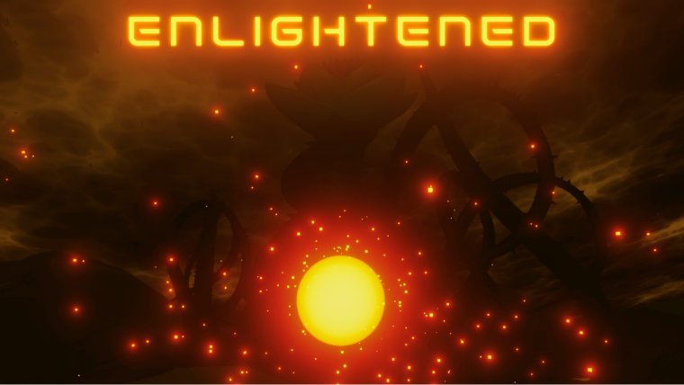
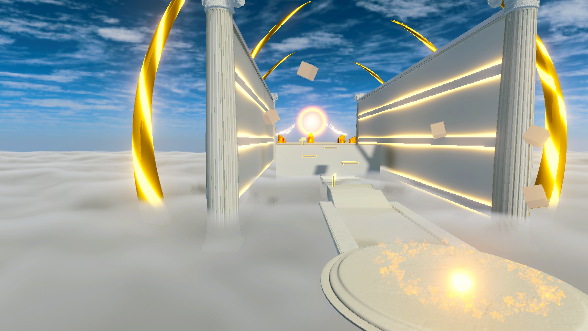

# Enlightened
Enlightened is a school project game, developed in Unity game engine

  

## STORY
A scientist, once, was doing tests in a plant with a certain substance, which one of his assistants missed the amount,
resulting in a catastrophic disaster, destroing and conquering the LAB and spreading itself to lands beyond.

After that, a previous experiment from this scientist, a photon, gets out of where it was, and proceeds going through challenges until the
plant, in order to defeat it.

## INSPIRATIONS
Started from a prank, the game united the physics class, professors and some students, evolving the ideas as an organic way through approximately 8 months.

---

  
 
<i align="center"> In game tutorial </i>

During my 2nd year in high school, I learned how to use Unity3D, as well as game design; programming; music, and developed this indie game prototype.

The game is mainly a platform/parkour game with new skills being unlocked each level. 